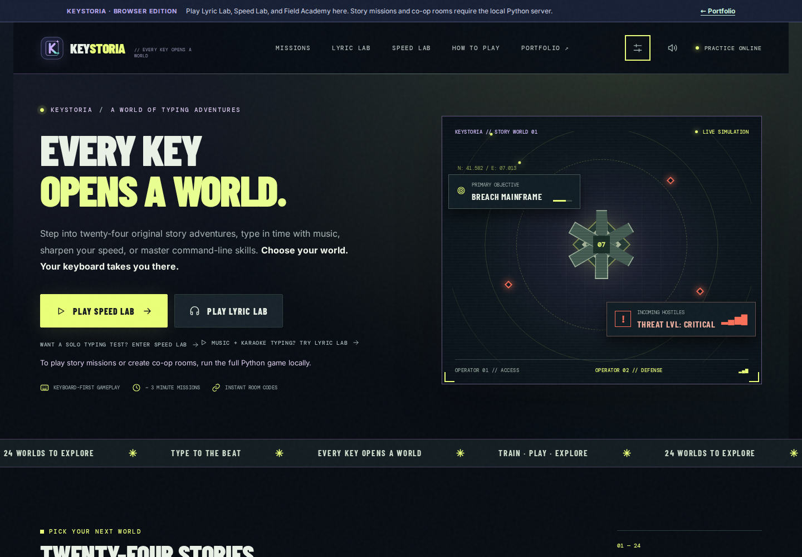
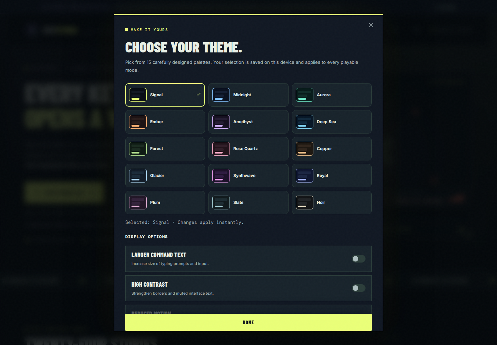
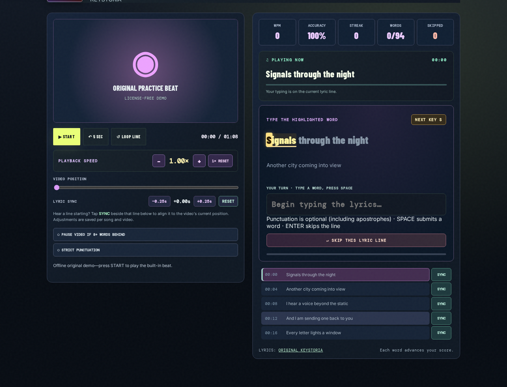
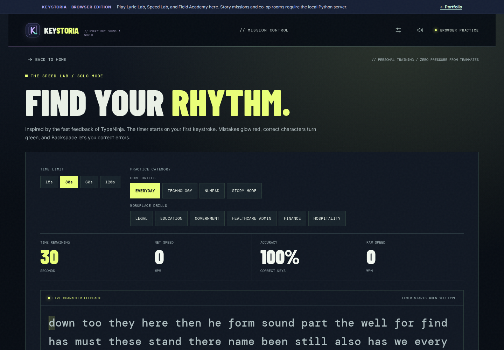
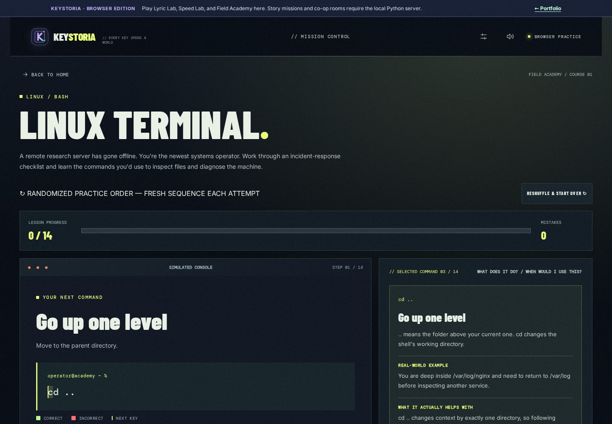
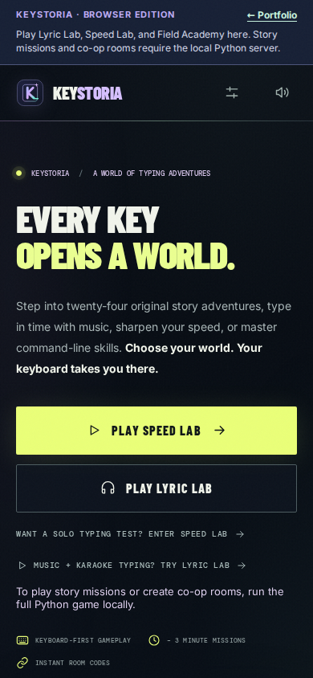
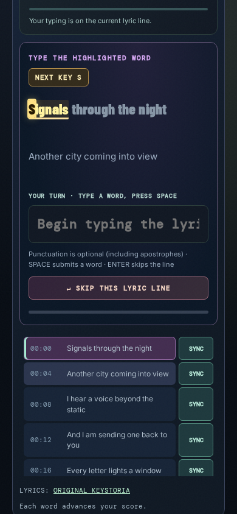
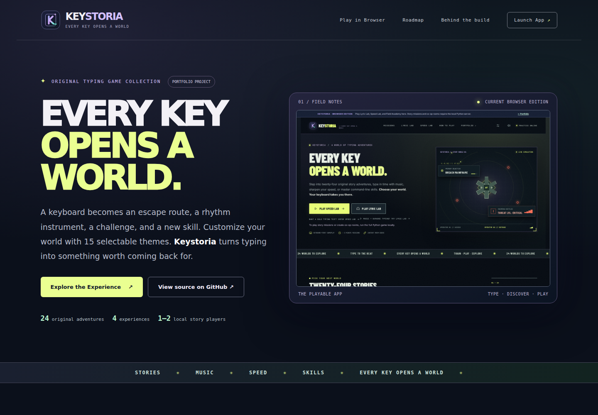

<div align="center">

# Keystoria

**Every key opens a world.**

A story-driven typing game where every keystroke moves the adventure forward.

**24 cooperative adventures · Lyric Lab · Speed Lab · Field Academy**

[Portfolio website](https://keystoria.masynnay.com/) · [Play in browser](https://keystoria.masynnay.com/play/) · [Roadmap](docs/ROADMAP.md) · [Features](#features) · [Get started](#get-started) · [How it works](#how-it-works)

</div>

---

## Turn typing practice into an adventure

Keystoria brings together cooperative story missions, music-inspired typing challenges, timed speed tests, and practical command-line exercises. Instead of repeating random words, players can explore different ways to build typing speed, accuracy, and confidence.

The project began as *Panic Protocol* and evolved into a broader collection of typing experiences. Keystoria is the new name for that expanded vision.

> **Portfolio project:** The public website showcases Keystoria and links to the playable browser edition for Lyric Lab, Speed Lab, and Field Academy. The full 24-mission cooperative story experience requires the local Python/WebSocket server.

## Screenshots

These are **Chromium captures of the current Keystoria browser edition**, not mockups or screenshots from an earlier design. The [screenshot capture workflow](.github/workflows/readme-screenshots.yml) uses the actual site files and exercises the UI before taking each image.

### The playable experience

The Keystoria browser app, with the current **K logo**, story gallery, and entry points to all three playable practice modes.

[](https://keystoria.masynnay.com/play/)

<sub>Current browser interface · [Launch Keystoria](https://keystoria.masynnay.com/play/)</sub>

### Choose your look

Use the in-game Settings panel to switch between 15 palettes. Changes apply immediately and stay saved in your browser.



### Lyric Lab

The original built-in song, timed lyric display, playback controls, live typing feedback, and next-key indicator—all inside the working Lyric Lab screen.



### Speed Lab and Field Academy

<table>
  <tr>
    <td width="50%" align="center"></td>
    <td width="50%" align="center"></td>
  </tr>
  <tr>
    <td align="center"><sub>Speed Lab · Timed typing, WPM and accuracy</sub></td>
    <td align="center"><sub>Field Academy · Linux command practice</sub></td>
  </tr>
</table>

### Responsive browser experience

<table>
  <tr>
    <td width="50%" align="center"></td>
    <td width="50%" align="center"></td>
  </tr>
  <tr>
    <td align="center"><sub>Browser edition · Mobile viewport</sub></td>
    <td align="center"><sub>Lyric Lab · Mobile viewport</sub></td>
  </tr>
</table>

### Portfolio website

[](https://keystoria.masynnay.com/)

<sub>Portfolio homepage · [Visit the website](https://keystoria.masynnay.com/)</sub>

**Play the app:** [Lyric Lab, Speed Lab, and Field Academy](https://keystoria.masynnay.com/play/) run in the browser. The full 24-mission story campaign and co-op rooms require the Python/WebSocket server.

<sub>Screenshot source: [automatic Chromium capture](scripts/capture-readme-screenshots.mjs) · [verified GitHub Actions run](https://github.com/MasynNay/Keystoria/actions/runs/42421318455)</sub>

## Features

- **15 selectable visual themes.** Switch instantly between polished, high-contrast palettes in Settings. Your appearance stays saved across visits and does not change when you select another story.

- **24 cooperative story adventures.** Progress through themed missions by typing under pressure, with shared objectives and real-time multiplayer gameplay.
- **Lyric Lab.** Practice typing along with synchronized lyrics, highlighted words, letter-by-letter feedback, and a flashing next-key cue. In normal mode, punctuation—including apostrophes and parentheses—is optional; strict punctuation remains an opt-in challenge.
- **Speed Lab.** Work on typing speed and accuracy through focused challenges.
- **Field Academy.** Practice useful command-line typing in a game-oriented environment.
- **Responsive interface.** A browser frontend designed for desktop and smaller screens, with a responsive 15-theme selector.
- **Progress compatibility.** The rebrand preserves existing internal save identifiers so earlier progress is not discarded solely because of the new name.

## Portfolio experience

The [Keystoria portfolio website](https://keystoria.masynnay.com/) is a GitHub Pages showcase introducing the game modes, design, and technical implementation. Select **Explore the Experience** to open the [playable browser edition](https://keystoria.masynnay.com/play/) featuring Lyric Lab, Speed Lab, and Field Academy.

The full playable application is included under `app/`. The hosted practice modes reuse its actual JavaScript frontend; story campaigns and room-based multiplayer still require the Python backend. The public site does **not** claim to offer hosted co-op.

GitHub Actions deploys **only `site/`**, including `site/play/` and its browser-compatible application modules. The Python engine under `app/` remains available for local play and development.

## Get started

### Play in your browser

Open **https://keystoria.masynnay.com/play/** for Lyric Lab, Speed Lab, and Field Academy. The hosted story mission gallery is a preview only. To play story missions and co-op, run the Python server locally. External song and video availability varies; the built-in lyric practice track works offline.

### Run the game locally

**macOS:** Open `app/` and run `run_mac.command`.

**Windows:** Open `app/` and run `run_windows.bat`.

**Manual setup** (Python 3.10+):

```bash
cd app
python -m pip install -r requirements.txt
python -m server.app
```

Then open **http://127.0.0.1:8080** in your browser.

### Publish the portfolio

The static site source is in `site/`. The GitHub Actions workflow at `.github/workflows/pages.yml` publishes this folder when changes are pushed to `main`.

To enable the hosting source and configure `keystoria.masynnay.com`, follow [GitHub Pages and Cloudflare deployment](docs/DEPLOY_GITHUB_DESKTOP.md).

## How it works

```text
Keystoria
├── Public website · GitHub Pages (site/)
│   ├── Portfolio homepage
│   └── Browser practice (site/play/)
│       ├── Lyric Lab
│       ├── Speed Lab
│       └── Field Academy
└── Full local game (app/)
    ├── JavaScript frontend
    └── Python · aiohttp + WebSockets
        ├── 24 story missions
        ├── ECHO solo teammate
        └── Private co-op rooms
```

The browser practice modes run directly on GitHub Pages. The full story campaign uses a local Python `aiohttp` server and WebSockets to coordinate sessions, mission state, and cooperative gameplay. The browser handles the interface and immediate typing feedback.

## Repository structure

```text
Keystoria/
├── .github/workflows/        GitHub Pages and screenshot capture workflows
├── app/                      Complete playable game and automated tests
│   ├── server/               Python backend and WebSocket logic
│   ├── web/                  Interactive browser interface
│   ├── tests/                Automated test suite
│   └── docs/                 Game documentation and screenshots
├── site/                     Static portfolio published to GitHub Pages
│   ├── assets/               Portfolio images and logo
│   ├── index.html            Portfolio homepage
│   ├── styles.css            Portfolio styling
│   └── play/                 Original browser interface, adapted for static hosting
├── docs/                     Roadmap, publishing and DNS instructions
├── .gitattributes               GitHub Linguist settings for build helpers
├── .gitignore
├── LICENSE
└── README.md
```

For details on the theme system, see [Themes and customization](docs/THEMES.md).

## Development roadmap

Keystoria is an evolving project. The [public roadmap](docs/ROADMAP.md) documents shipped milestones, near-term work, and longer-term ideas. Every planned item has an open [GitHub Issue](https://github.com/MasynNay/Keystoria/issues) with acceptance criteria; a plan is not the same as a completed feature.

**Current priorities:** automated browser regression checks ([#1](https://github.com/MasynNay/Keystoria/issues/1)) and robust Lyric Lab failure handling ([#2](https://github.com/MasynNay/Keystoria/issues/2)). Later work includes accessibility, safe co-op hosting research, and meaningful practice progression. See [the roadmap on the portfolio](https://keystoria.masynnay.com/#roadmap) for a quick overview.

## Development and testing

The project includes automated tests under `app/tests/`, along with development notes and checkpoints. The source includes the v0.24 Keystoria rebrand and the Lyric Lab next-key typing indicator.

For the latest development handoff, see [CONTINUE_HERE.md](app/CONTINUE_HERE.md). For the latest copy, layout, and deployment validation, see [Editorial QA](docs/EDITORIAL_QA.md).

## Technology

- **Frontend:** HTML, CSS, vanilla JavaScript
- **Backend:** Python, aiohttp
- **Real-time communication:** WebSockets
- **Portfolio hosting:** GitHub Pages with GitHub Actions
- **Version control:** Git and GitHub

## Project notes

Keystoria is an independent portfolio project. No commercial music recordings, video sources, or copyrighted songs are distributed in this repository. Third-party content, music-provider access, and branding rights require separate review before broader public distribution.

## License

MIT — see [LICENSE](LICENSE).
