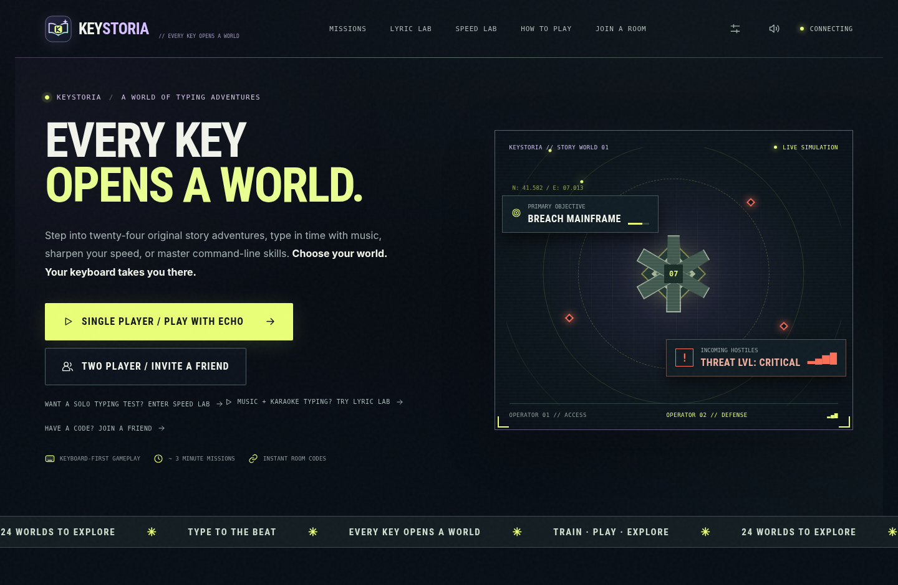

# Keystoria

**Every key opens a world.**

Keystoria is a portfolio project combining **24 cooperative typing adventures**, **Lyric Lab**, **Speed Lab**, and a **Field Academy** for practical command typing. It uses a Python `aiohttp` WebSocket backend and a vanilla JavaScript frontend.

**Portfolio:** https://keystoria.masynnay.com  
**Source:** https://github.com/MasynNay/keystoria



## What's in the repository?

| Path | Purpose |
| --- | --- |
| `index.html`, `styles.css`, `assets/` | GitHub Pages static showcase |
| `CNAME` | GitHub Pages custom domain: `keystoria.masynnay.com` |
| `app/` | Full Keystoria v0.24 playable application source |
| `app/server/` | Python server / real-time multiplayer logic |
| `app/web/` | Interactive browser game |
| `app/tests/` | Automated tests |
| `app/docs/` | Architecture, gameplay, screenshots, testing and developer notes |

## Run the actual game locally

**On macOS:**

1. Clone this repository or download its ZIP.
2. Open the `app` directory.
3. Run `run_mac.command` (double-click, or `bash run_mac.command` in Terminal).
4. Open http://127.0.0.1:8080.

**On Windows:** open `app/`, then run `run_windows.bat`.

**Cross-platform manual setup** (Python 3.10+):

```bash
cd app
python -m pip install -r requirements.txt
python -m server.app
```

Then visit http://127.0.0.1:8080.

## Hosting the showcase

This repository is **ready for GitHub Pages**: use `main` branch, `/ (root)` as the publishing source. The `CNAME` file sets the intended custom domain. Configure a matching DNS record with your domain provider:

| Type | Name | Target | Proxy |
| --- | --- | --- | --- |
| `CNAME` | `keystoria` | `masynnay.github.io` | DNS only (if using Cloudflare) |

The GitHub Pages **Custom domain** should read `keystoria.masynnay.com`; enable **Enforce HTTPS** when it becomes available.

For the exact clicks in GitHub Desktop and Cloudflare, read [`DEPLOY_GITHUB_DESKTOP.md`](DEPLOY_GITHUB_DESKTOP.md).

**Important:** The GitHub Pages site is a static *showcase*, not the playable game. GitHub Pages cannot run the Python server or two-player WebSocket sessions. This distinction is intentional, and no working online demo is claimed.

## Technical notes

- The core game lives in `app/`; enter that directory before running any app commands.
- See [`app/CONTINUE_HERE.md`](app/CONTINUE_HERE.md) to resume development.
- No audio/video sources or commercial songs are distributed in this repository.
- New features should be checked for music, trademark and third-party content rights before broader distribution.

## License

MIT, see [`LICENSE`](LICENSE).
