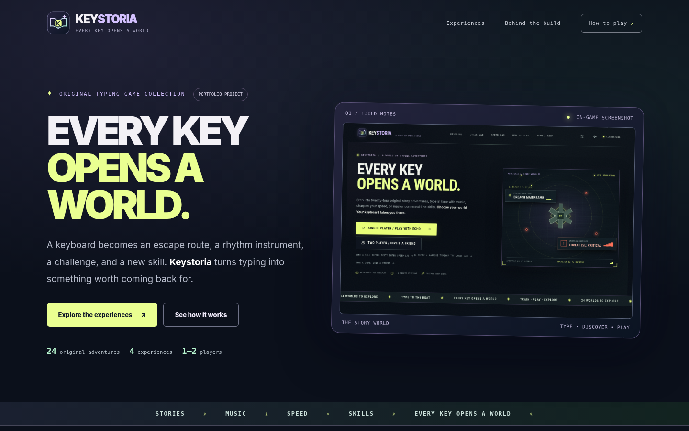
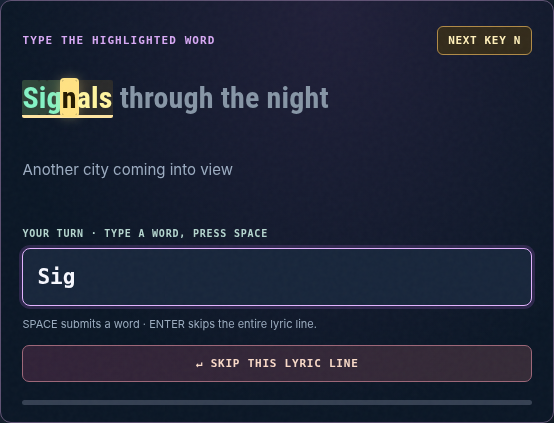
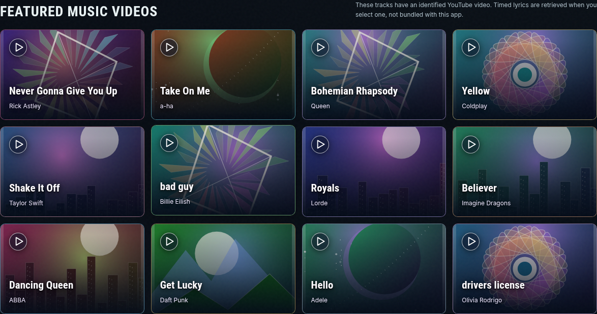
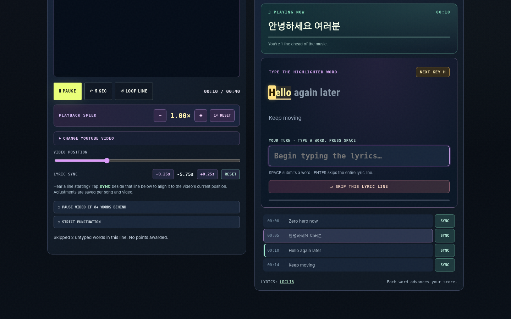
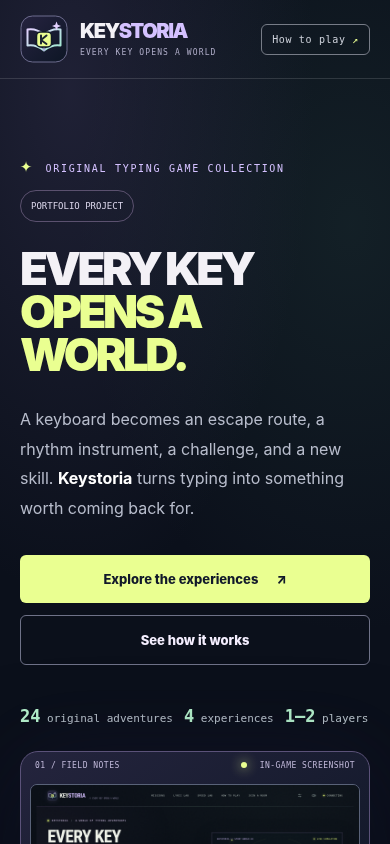
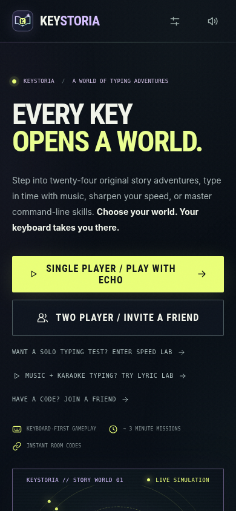
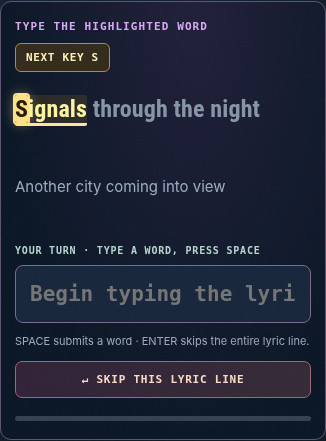

<div align="center">

# Keystoria

**Every key opens a world.**

A story-driven typing game where every keystroke moves the adventure forward.

**24 cooperative adventures · Lyric Lab · Speed Lab · Field Academy**

[Portfolio website](https://keystoria.masynnay.com/) · [Play in browser](https://keystoria.masynnay.com/play/) · [Roadmap](docs/ROADMAP.md) · [Features](#features) · [Get started](#get-started) · [How it works](#how-it-works)

</div>

---

## Turn typing practice into an adventure

Keystoria brings together cooperative story missions, music-inspired typing challenges, timed speed tests, and practical command-line exercises. Instead of repeating random words, players can explore different ways to build typing speed, accuracy, and confidence.

The project began as *Panic Protocol* and evolved into a broader collection of typing experiences. Keystoria is the new name for that expanded vision.

> **Portfolio project:** The public website showcases Keystoria and links to the playable browser edition for Lyric Lab, Speed Lab, and Field Academy. The full 24-mission cooperative story experience requires the local Python/WebSocket server.

## Screenshots

A closer look at the **actual Keystoria experience**, from the public portfolio to the typing interface. These images are captured from the project rather than promotional mockups.

### Explore the experience

The portfolio introduces Keystoria's worlds and opens the playable browser edition.

[](https://keystoria.masynnay.com/)

<sub>Portfolio homepage · [Open website](https://keystoria.masynnay.com/)</sub>

### Inside the game

The main game interface brings together the story adventures and typing modes.


<sub>Game interface · [Open playable browser edition](https://keystoria.masynnay.com/play/)</sub>

### Lyric Lab — type with the music

Lyric Lab highlights the current word and provides a next-character cue to make it easier to follow along.



<sub>Lyric Lab · Next-key feedback and word highlighting</sub>

### Music experience

The music-focused interface also includes artwork and synchronized video presentation.

<table>
  <tr>
    <td width="50%" align="center"></td>
    <td width="50%" align="center"></td>
  </tr>
  <tr>
    <td align="center"><sub>Artwork and song presentation</sub></td>
    <td align="center"><sub>Video synchronization interface</sub></td>
  </tr>
</table>

### Responsive layouts

Keystoria includes layouts for smaller screens as well as desktop browsers.

<table>
  <tr>
    <td width="33%" align="center"></td>
    <td width="33%" align="center"></td>
    <td width="33%" align="center"></td>
  </tr>
  <tr>
    <td align="center"><sub>Portfolio</sub></td>
    <td align="center"><sub>Game interface</sub></td>
    <td align="center"><sub>Lyric Lab</sub></td>
  </tr>
</table>

**Want to try it?** [Play Lyric Lab, Speed Lab, and Field Academy in your browser](https://keystoria.masynnay.com/play/). The 24 cooperative story missions still require the local Python server.

## Features

- **24 cooperative story adventures.** Progress through themed missions by typing under pressure, with shared objectives and real-time multiplayer gameplay.
- **Lyric Lab.** Practice typing along with synchronized lyrics, with highlighted words, letter-by-letter feedback, and a flashing cue for the next expected key.
- **Speed Lab.** Work on typing speed and accuracy through focused challenges.
- **Field Academy.** Practice useful command-line typing in a game-oriented environment.
- **Responsive interface.** A themed browser frontend designed for desktop and smaller screens.
- **Progress compatibility.** The rebrand preserves existing internal save identifiers so earlier progress is not discarded solely because of the new name.

## Portfolio experience

The [Keystoria portfolio website](https://keystoria.masynnay.com/) is a static product showcase hosted using GitHub Pages, and its **Explore the Experience** button opens [the real browser interface](https://keystoria.masynnay.com/play/) for Lyric Lab, Speed Lab, and Field Academy. It introduces the project, its game modes, design, and technical implementation.

The full playable application is included under `app/`. The hosted practice modes reuse its actual JavaScript frontend; story campaigns and room-based multiplayer still require the Python backend. The public site does **not** claim to offer hosted co-op.

GitHub Actions deploys **only `site/`**, including `site/play/` and its browser-compatible application modules. The Python engine under `app/` remains available for local play and development.

## Get started

### Play in your browser

Open **https://keystoria.masynnay.com/play/** for Lyric Lab, Speed Lab, and Field Academy. The story mission gallery is a preview until a Python server is available. Music/video lookup requires accessible third-party services; original timed-lyrics practice works offline.

### Run the game locally

**macOS:** Open `app/` and run `run_mac.command`.

**Windows:** Open `app/` and run `run_windows.bat`.

**Manual setup** (Python 3.10+):

```bash
cd app
python -m pip install -r requirements.txt
python -m server.app
```

Then open **http://127.0.0.1:8080** in your browser.

### Publish the portfolio

The static site source is in `site/`. The GitHub Actions workflow at `.github/workflows/pages.yml` publishes this folder when changes are pushed to `main`.

To enable the hosting source and configure `keystoria.masynnay.com`, follow [GitHub Pages and Cloudflare deployment](docs/DEPLOY_GITHUB_DESKTOP.md).

## How it works

```text
Browser interface
    |
    +-- Story missions / multiplayer ---+
    +-- Lyric Lab                       |
    +-- Speed Lab                       +--> Python aiohttp server
    +-- Field Academy                   |        |
    |                                   |        +--> Game state and sessions
    +-- Live typing feedback -----------+        +--> WebSocket updates
```

Keystoria combines a vanilla JavaScript frontend with a Python `aiohttp` backend. WebSockets support real-time gameplay, while the browser handles responsive presentation and immediate typing feedback.

## Repository structure

```text
Keystoria/
├── .github/workflows/        Automatic GitHub Pages publishing
├── app/                      Complete playable game and automated tests
│   ├── server/               Python backend and WebSocket logic
│   ├── web/                  Interactive browser interface
│   ├── tests/                Automated test suite
│   └── docs/                 Game documentation and screenshots
├── site/                     Static portfolio published to GitHub Pages
│   ├── assets/               Portfolio images and logo
│   ├── index.html            Portfolio homepage
│   ├── styles.css            Portfolio styling
│   └── play/                 Original browser interface, adapted for static hosting
├── docs/                     Roadmap, publishing and DNS instructions
├── .gitignore
├── LICENSE
└── README.md
```

## Development roadmap

Keystoria is an evolving project, with [a public roadmap](docs/ROADMAP.md) documenting shipped milestones, near-term work, and longer-term ideas. Every planned item has an open [GitHub Issue](https://github.com/MasynNay/Keystoria/issues) with acceptance criteria; a plan is not the same as a completed feature.

**Current priorities:** automated browser regression checks ([#1](https://github.com/MasynNay/Keystoria/issues/1)) and robust Lyric Lab failure handling ([#2](https://github.com/MasynNay/Keystoria/issues/2)). Later work includes accessibility, safe co-op hosting research, and meaningful practice progression. See [the roadmap on the portfolio](https://keystoria.masynnay.com/#roadmap) for a quick overview.

## Development and testing

The project includes automated tests under `app/tests/`, along with development notes and checkpoints. The source includes the v0.24 Keystoria rebrand and the Lyric Lab next-key typing indicator.

For the latest development handoff, see [CONTINUE_HERE.md](app/CONTINUE_HERE.md).

## Technology

- **Frontend:** HTML, CSS, vanilla JavaScript
- **Backend:** Python, aiohttp
- **Real-time communication:** WebSockets
- **Portfolio hosting:** GitHub Pages with GitHub Actions
- **Version control:** Git and GitHub

## Project notes

Keystoria is an independent portfolio project. No commercial music recordings, video sources, or copyrighted songs are distributed in this repository. Third-party content, music-provider access, and branding rights require separate review before broader public distribution.

## License

MIT — see [LICENSE](LICENSE).
