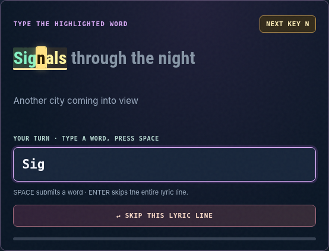

# KEYSTORIA

**Every key opens a world.** A collection of story-driven typing games and practice experiences.

Keystoria brings together twenty-four illustrated cooperative story missions, Lyric Lab, Speed Lab, and Field Academy. Story Mode combines keyboard practice with original illustrated adventures. One operator completes the mission while another intercepts threats. In **Single Player**, ECHO handles the other position automatically. In **Two Player**, a friend joins by room code. Players switch roles midway through a mission.

> **v0.24 — The Keystoria Rebrand.** An actively developed open-source portfolio prototype, not a finished commercial game. Six new original adventures expand the campaign to twenty-four missions. The game uses local SVG/CSS animation; it is not AAA/film-grade 3D and does not require downloaded cutscene videos.

See [portfolio deployment options](docs/PORTFOLIO_DEPLOYMENT.md) before hosting: **GitHub Pages is not sufficient for the live campaign** because multiplayer and automatic video matching use a Python server. A static portfolio showcase can display screenshots and explain the project.

## Identity and continuity

The project was formerly called **Panic Protocol**. Keystoria is the current name, but existing `panic.*` localStorage and sessionStorage keys are **intentionally retained** to preserve saved progress and linked music. Older development journal entries and legacy browser previews retain historic naming for traceability.

## Get started

Requirements: Python **3.9+** (3.12 recommended), pip, and a modern desktop browser. No account, API key, database, or external game emulator is required.

**macOS**

1. Extract the release archive (.tar.gz on macOS, or ZIP) and open `keystoria`.
2. Double-click `run_mac.command` or run `bash run_mac.command` inside Terminal.
3. Open **http://localhost:8080**. To use a different port: `PORT=8089 bash run_mac.command`.

**Windows:** Double-click `run_windows.bat`. **Linux:** Run `python3 -m venv .venv`, then `.venv/bin/pip install -r requirements.txt`, followed by `.venv/bin/python -m server.app`.

The homepage initially shows **three featured mission cards**; click **VIEW ALL 24 MISSIONS** to expand the gallery. Your selected mission stays visible when you collapse it again.

The welcome guide appears on each visit to the main page. Choose **Single Player / Play with ECHO** to start on your own, or **Two Player / Invite a Friend** to host a private room. You can select any of the twenty-four missions before starting.

In a story, read the briefing and confirm you're ready. A **10-second preparation countdown** runs, then the mission waits for you to press **PLAY MISSION**. In duo mode both humans press Play. The clock and enemies stay paused until the game begins.

Type the highlighted command in the right-hand console. Correct characters are highlighted, errors are shown, and Backspace corrects them. The left-hand scene changes as you type and when objectives are completed. Complete the hacker's objectives, defend incoming attacks, resolve the tactical choices, and survive the role swap to reach the mission ending.

## Lyric Lab (updated v0.23)



From the homepage choose **ENTER LYRIC LAB** to play a separate music-backed typing challenge. The main story campaign, two-player rooms, Speed Lab and Academy are unchanged. You do **not** need to own or upload MP3s, lyric files, or provide an API key.

- Pick one of **12 featured tracks**, each paired with a known YouTube video ID, or search LRCLIB for timestamped lyrics by song/artist. For other tracks, selecting a song automatically tries to find an eligible YouTube recording. Existing public MusicBrainz links work without credentials; the app can also search YouTube much more widely when the host configures the optional YouTube Data API key. If no confident match is found, **FIND ON YOUTUBE** and **CONNECT VIDEO** are still available. Listeners never need MP3 files, lyric-file uploads, or their own account.
- Lyric Lab loads synchronized lines on demand from LRCLIB and runs a visible official YouTube iframe where a video match is known. It shows the current word, the next line, timing, WPM, accuracy, streak and progress.
- **New v0.23:** While typing, the yellow active-word highlight stays visible and the precise next letter pulses inside the displayed lyric. Typed letters become green or red, and the **NEXT KEY** badge updates on every keystroke, switching to **SPACE** when the word is complete. Optional punctuation and accented letters remain aligned with relaxed matching; strict matching requires the literal character. Reduced-motion settings disable flashing.
- **SPACE** submits the current word; **ENTER** skips the rest of the current lyric line, including Japanese/Korean or any script you cannot type. A visible **SKIP THIS LYRIC LINE** button works on mobile. Skipped words count as missed in accuracy and award no credit.
- The *PLAYING NOW* panel follows the YouTube player's clock independently of the highlighted *YOUR TURN* typing line, so you can see when you are behind or ahead. Each lyric line has a **SYNC** button: tap it exactly when you hear the line begin. The lyric offset is saved for that song and YouTube recording; fine-adjust it by ±0.25 seconds or reset. Recordings with obviously different video/lyric durations warn of potentially different edits. Remote services cannot guarantee perfect alignment automatically across every upload.
- Featured videos show YouTube-hosted video thumbnails when available; every other track receives distinctive, original geometric poster art, not a copied album cover. The covers also provide a fallback if YouTube thumbnail images are blocked.
- Jump to a line, loop a line to practice, rewind, and optionally pause playback if you fall eight or more words behind. **Slow down or speed up** with the visible playback-rate controls (0.5×–2× where YouTube supports it); timing follows the video clock. The offline demo also changes tempo and clock speed.
- The app does not download or redistribute YouTube music. Automatic lookup occurs on song selection, not as an expensive background search of every result. MusicBrainz may lack a video relation; broad automatic YouTube discovery requires a server-side YouTube Data API key. The server caches results and avoids live/cover/remix/duration mismatches when it can. No algorithm can guarantee the right recording for every song or that a matched video will embed. Some videos cannot be embedded or do not support every playback speed.
- For offline testing, the **original demo** has original text and a small generated electronic practice beat; no audio files or remote services required.
- Lyrics are copyrighted works owned by their authors and publishers. A public lyrics API or a YouTube embed is **not** a blanket lyrics-reproduction license. Review rights and third-party terms before publishing a commercial service. See [`docs/LYRIC_LAB.md`](docs/LYRIC_LAB.md).

## What you can play

| Experience | What it offers |
| --- | --- |
| **Story missions** | Twenty-four different settings with original objectives, threats, dialogue, visual actions, decisions, and story endings |
| **Single Player** | Play alongside ECHO, an automated partner with no cloud AI dependency |
| **Two Player** | Asymmetric browser-based cooperation using a private room code and WebSocket communication |
| **Lyric Lab** | Karaoke-style timed lyric typing with live YouTube video for matched tracks and on-demand LRCLIB search |
| **Speed Lab** | Classic timed typing sessions: 15, 30, 60, or 120 seconds, live WPM and accuracy, personal bests |
| **Field Academy** | Three randomized courses of simulated Linux, Windows PowerShell, and macOS commands; practical explanations and sample output |

**The first eighteen missions:** Station Zero, The Hollow House, Patient Zero, The Last Alibi, Dead Air, Last Stop, Abyss Nine, Neon Heist, Red Horizon, Whiteout, Ashfall, Carnival 13, Mirrorfall, Four Winds, Dawnforge, The Glass Trials, Wildbond, and The Last Stardoor.

**New v0.22 chapters:** Clockfall, The Dream Market, Emberwing Refuge, The Drowned Archive, Aurora Arc, and Inkbound Kingdom.

The adventure commands are fictional. Field Academy commands are informational only and are **never executed on your computer**.

## What's new in v0.22

- **Six playable new missions (19–24):** Clockfall (time loop), The Dream Market (stolen dreams), Emberwing Refuge (dragon sanctuary), The Drowned Archive (submerged library), Aurora Arc (orbital colony), and Inkbound Kingdom (living storybook). Each has eleven stage objectives, ten distinct defender prompts, authored dialogue, separate mission artwork, a tactical fork, crisis, optional interventions, a role swap, and a concrete ending.
- **More keyless automatic YouTube matching:** Selecting an LRCLIB result now queries documented public Invidious and Piped metadata-search indexes alongside MusicBrainz, in parallel, when no `YOUTUBE_API_KEY` is configured. Matches are filtered by artist/title, edition and duration, cached, and passed to the **official embedded YouTube player**. No media downloading, file uploads, or user-supplied video IDs required when a match is found.
- **Limits:** Public metadata hosts frequently change, rate-limit, or go offline. Their candidate video IDs may not embed and may have different intros, so a song is **not guaranteed** to auto-connect even with a match. For reliably wider coverage, configure the optional official YouTube Data API key. Manual link and lyric SYNC controls remain available.
- Campaign action progression is server authoritative; CSS/SVG effects cannot award typed words or skip objectives. Illustrations are original 2D motion graphics, not AAA animation.

## What's new in v0.21

- **Automatic video matches on song selection:** LRCLIB search results are checked against established YouTube links in MusicBrainz, and optionally the official YouTube Data API. Manual paste is now a fallback, not the default experience.
- **Matching quality controls:** normalize artist/title display tags, validate YouTube IDs, compare artist names and song duration when available, reject obvious covers, live edits and remixes, and prefer verified embeddable official videos. A video found via MusicBrainz is a catalog association and may still be unavailable in YouTube's player.
- **Remember matches:** save the resolved video ID per lyrics record in browser local storage. The server caches positive matches for up to 15 days and negative matches for 30 minutes, with a bounded 500-entry in-memory cache.
- **No API key required for basic play or catalog lookup:** MusicBrainz matching works without credentials. For substantially broader automatic YouTube matching, the **server operator** can configure `YOUTUBE_API_KEY`; see below. The key is never served to the browser, and a key is never required from individual listeners.
- **Known limits:** music records without useful metadata or video links, low matching confidence, blocked embeds, regional restrictions, and quota limits remain possible. The manual link field and video-specific lyric-sync controls remain available.

### Enable broader automatic YouTube matching (server operator, optional)

The official YouTube Data API needs a Google Cloud project with **YouTube Data API v3 enabled** and a key with appropriate API restrictions. This is a **one-time server setting**, not a requirement for every song or every listener. On your Mac, set `YOUTUBE_API_KEY` in the environment before launching the server. Example:

```bash
YOUTUBE_API_KEY="your-key-from-google-cloud" PORT=8095 bash run_mac.command
```

Protect your key; don't put it into `web/`, commit it to GitHub, or embed it in a public JavaScript file. API search quotas and usage restrictions apply. Without a key, the game tries publicly available Invidious/Piped metadata indexes and MusicBrainz matches, featured videos, remembered associations, and manual fallback. YouTube playback itself uses the standard visible IFrame Player, not a downloader. See [official YouTube API documentation](https://developers.google.com/youtube/data/reference/rest/v3/search/list).

## What's new in v0.20

- **Artwork on song cards**: official YouTube-hosted video thumbnails for linked videos (including all 12 featured), with per-track original generative abstract covers for search results and offline fallback. No copied album artwork or cover downloads are bundled.
- **Non-Latin lyric skip**: Enter skips the rest of the line, Space submits words, and a dedicated skip control works on touchscreen. Korean, Japanese and other unfamiliar scripts no longer trap the player. Skipped words lower accuracy and never award WPM, streaks or points.
- **Video-anchored lyrics**: the karaoke panel shows the line that is actually playing, separate from the user's typing position; the timeline and lyric progress follow YouTube's current time. Track/video-specific quarter-second offset adjustments persist, with one-touch SYNC beside any lyric line and a duration-mismatch warning for different video edits.
- **No regressions**: 18 mission stories, two-player, Speed Lab, Academy, the compact campaign gallery, music search, YouTube video linking and playback speed are preserved.

## What's new in v0.19

- **Collapsed mission gallery:** start with three operations, expand all eighteen on demand, keep the selected operation visible even after collapsing.
- **Lyric Lab playback speed:** 0.5× to 2× where supported, with actual available rates detected from the official YouTube IFrame Player API. The offline demo clock and beat also follow the selected speed.
- **No-file music for searched songs:** a clear **FIND ON YOUTUBE** action and **CONNECT VIDEO** form, validated official video URLs, saved track-to-video associations in localStorage, a visible player, and a helpful error if a video disallows embedding.
- **Regression tests:** pure YouTube URL/rate validation, expanded/collapsed gallery, and real Chromium interaction tests for searched-song linking and YouTube rate changes using a mocked player. Real third-party streaming requires a live browser check.

## What's new in v0.18

- Give all eighteen mission cards separate foreground, icon and cover palettes; fix the six newest cards incorrectly falling back to Station Zero blue.
- Add Lyric Lab with 12 ready-to-select YouTube video pairings, LRCLIB timed-lyric search, line-by-line typing, WPM, accuracy, streaks, practice loop, manual synchronization offset, catch-up assist, original offline demo, and local result history.
- Use official YouTube IFrame Player API for playback and link to lyric source. No user-uploaded audio or lyric files.
- Add unit tests for matching, scoring, lyrics parsing, API failures and eighteen unique color identities, plus offline Chromium interactions.

## What's new in v0.17

- **Six new original missions:** Mirrorfall (a physically inverted city), Four Winds (an elemental sabotage), Dawnforge (the stolen sunrise), The Glass Trials (a deadly competition cover-up), Wildbond (a creature-rescue betrayal), and The Last Stardoor (a fantasy network of stolen memories). Genre homages, **not licensed adaptations** or copies of other stories or characters.
- **Story causality audit** across all 18 missions, including both operators' roles, the action order, twists, concrete endings and which scenes reveal information. Corrected premature dialogue and several story inconsistencies in the original 12 chapters. See [Story audit](docs/STORY_AUDIT.md).
- **More reactive visuals** within the existing cockpit: six new mission-specific worlds, dynamic action props for elemental wards, creatures, the forge, and story portals; objective-aware cues now follow the phrase you're really typing.
- **Reality flip in Mirrorfall.** After crossing the threshold, the physical world rotates 180°. The final rescue restores it upright. The typing console and HUD never invert. Reduced-motion preferences still apply.
- **Per-character message decoding:** the illustrated decoder can reveal an actual narrative clue, one character at a time, as correct typing advances. No text popup appears after completing a phrase.
- **Both perspectives:** mission controllers see action-specific visuals, while Defenders see live attack-countermeasure context and a separate intercept graphic, not a misleading animation of the other player's progress.
- **First-paint typing prompt** shows the real phrase immediately, avoiding a flash of `INITIALIZING...` while the initial snapshot populates.

The existing welcome dialog, Single Player first, multiplayer rooms, ten-second countdown and manual Play gate, original cockpit, Academy, and Speed Lab remain in place.

See `docs/STORY_AUDIT.md` and `docs/PLAYTEST.md` for the campaign and visual continuity audit.

## Project layout

```text
keystoria/
  server/               Python game engine, mission content, WebSocket API
  web/
    app.js              UI lifecycle, connection controller, event delegation
    ui/                 Page views, mission art, Academy, Speed Lab, progression
      scene-action-stage.js   Per-world action rigs and objective cues
      scene-legends.js        New six original animated environments
      cinematic-storyboards.js   Role-aware action/dialgoue beats
      scene-illustrations.js  SVG composition for the live story camera
      mission-scenes.js      Server-state-driven scene updates
    styles/             Component-scoped CSS and reduced-motion rules
  tests/                Engine, network, frontend, completion and visual tests
  docs/                 Architecture, manual playtest, completion evidence
  run_mac.command       macOS launcher
  run_windows.bat       Windows launcher
```

The **server owns** objective completion, timers, integrity, emergency decisions, role transitions, and mission outcomes. The browser owns presentation and typing feedback. Correct letters move the art while typing, but cannot bypass the server to complete objectives or award points.

Animated scenes use inline SVG and CSS rather than JavaScript animation loops or downloaded videos. Visual effects are noninteractive (`pointer-events: none`), do not cover the typing field, and honor reduced-motion settings.

## Testing

```bash
make check  # Python compilation and JavaScript syntax checks
make test   # Python unittest suite + Node test runner
```

Optional offline Chromium visual checks use real Python engine snapshots and locally rendered templates:

```bash
PYTHONPATH=. python tests/browser_v017.py
```

The test suite covers all eighteen mission completion routes across difficulty, solo/duo, tactical choices and rematches; the synchronized manual Play gate; real two-client WebSocket exchanges; Academy command order; Speed Lab; and the new story UI. **Offline browser snapshots do not count as real human multiplayer sessions.** Test two physical devices and actual story pacing before a public production release.

See [Architecture](docs/ARCHITECTURE.md), [Completion matrix](docs/COMPLETION_MATRIX.md), [Playtest guide](docs/PLAYTEST.md), and [Changelog](CHANGELOG.md).

## License

MIT, subject to the third-party notices and terms applicable to any independently used components. This prototype ships no copyrighted music, game ROMs, or hosted video assets.
